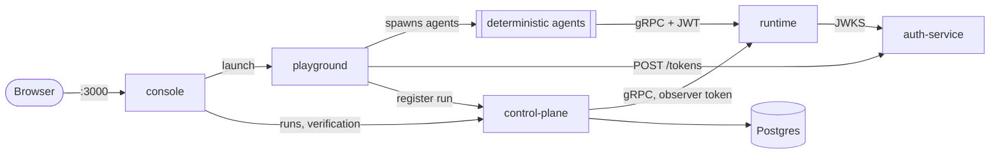

# Self-host the MACP stack

One command runs the whole stack on your machine: the runtime, the control
plane and its Postgres, the console, the playground, and auth-service. It needs
no GitHub token, no API key and no LLM key.

```bash
git clone https://github.com/multiagentcoordinationprotocol/macp-runtime
cd macp-runtime/deploy
docker compose up
```

Open <http://localhost:3000>, go to **Showcase**, and launch the run. It is a
four-agent fraud-review Decision. Within a few seconds it resolves, and the
run's verification panel reads **Verified ✓**: the control plane recomputed the
commitment hash (RFC-MACP-0013) from the stored Commitment and got the same
value the agents sealed.

You need Docker with Compose v2 (Docker Desktop, or Engine 24+). The images are
public on GHCR; the first `up` downloads several hundred MB.

## What runs



| Service | Image | Host port | Role |
|---|---|---|---|
| `console` | `macp-ui-console` | 3000 | The web UI. It calls the other services server-side, so the browser only needs this port. |
| `control-plane` | `macp-control-plane` | 3001 | Records runs and their events in Postgres, and verifies commitments. Observes the runtime; it sends no protocol messages. |
| `playground` | `macp-playground` | 3100 | **Spawns the agents.** A run launched from the console is a `POST /examples/run` here. Without it nothing sends messages, so no run can resolve. |
| `runtime` | `macp-runtime` | 50051 | The coordination kernel (this repo). |
| `auth-service` | `macp-auth-service` | — | Mints a JWT for each agent the playground spawns. The runtime validates them against its JWKS. |
| `postgres` | `postgres` | — | The control plane's database. The control plane runs its migrations at boot. |

Each service waits on a health check for the ones it needs, so `up` converges
on its own with no manual restarts.

**Deterministic by default.** The playground calls an LLM only when
`PLAYGROUND_ALLOW_LLM` is set. This file never sets it and passes no LLM key, so
every launch runs scripted agents. This matches the hosted playground.

## Credentials

The defaults are fixed local-dev values, so the stack works without any setup.
To change them, copy `.env.example` to `.env` and edit it.

| Credential | Default | Used by |
|---|---|---|
| `MACP_CP_API_KEY` | `macp-dev-key` | Every caller of the control plane API: the console, the playground and you. Send it as `Authorization: Bearer <key>`. |
| `MACP_CP_RUNTIME_TOKEN` | `macp-dev-cp-observer` | The control plane's static bearer to the runtime. The runtime maps it to sender `macp-control-plane` with observer rights. |
| `POSTGRES_PASSWORD` | `macp` | The control plane's database login. |

auth-service starts with an ephemeral signing key, so agent JWTs stop
validating after it restarts until the runtime refreshes its JWKS cache (60 s).

**This stack is for one machine.** Every port binds to `127.0.0.1`, and
auth-service is not published at all. auth-service mints a token for any sender
it is asked for, so do not expose this stack to a network as configured. For a
real deployment, see the runtime's [Deployment Guide](../docs/deployment.md).

## Using it

```bash
# Launch the showcase run without the console, then check it:
curl -s -X POST localhost:3100/examples/run -H 'content-type: application/json' \
  -d '{"scenarioRef":"fraud/high-value-new-device@1.0.0","templateId":"showcase","mode":"live","inputs":{},"bootstrapAgents":true}' \
  | jq -r .controlPlaneRun.runId
curl -s localhost:3001/runs/<runId>/verification -H 'authorization: Bearer macp-dev-key' | jq .status
```

`status` stays `pending` until the Commitment is recorded, then becomes
`verified`. `mismatch` and `cannot_verify` mean something is wrong.

| Task | Command |
|---|---|
| Run in the background | `docker compose up -d --wait` |
| Logs for one service | `docker compose logs -f playground` |
| Stop, keep data | `docker compose down` |
| Stop and delete all runs | `docker compose down -v` |
| Update after pulling new pins | `docker compose pull && docker compose up -d` |
| Use a runtime built from this checkout | `docker build -t macp-runtime:dev .. && MACP_RUNTIME_IMAGE=macp-runtime:dev docker compose up` |

Run history lives in two named volumes: `macp_postgres-data` holds the control
plane's runs, and `macp_runtime-data` holds the runtime's session logs.

## Image pins

Every image is pinned to a release tag in `docker-compose.yml`, never
`latest`. `scripts/check-pins.sh` enforces this. To try another version of one
service, set its `MACP_*_IMAGE` variable (see `.env.example`).

## Acceptance test

`scripts/acceptance.sh` is the test the `self-host` CI workflow runs. It brings
the stack up from nothing and launches the showcase run through the console's
proxy, the same path the Showcase button uses. It then waits for the control
plane to report `verified`, and tears everything down.

```bash
scripts/acceptance.sh              # needs docker compose, curl and jq
KEEP_STACK=1 scripts/acceptance.sh # leave the stack running afterwards
```

## Troubleshooting

- **`controlPlaneRun` is null.** The playground could not register the run.
  Check that `MACP_CP_API_KEY` has the same value for every service.
  `docker compose logs playground control-plane` shows the refusal.
- **A port is in use.** Set `MACP_CONSOLE_PORT`, `MACP_CP_PORT`,
  `MACP_PLAYGROUND_PORT` or `MACP_RUNTIME_PORT` in `.env`.
- **Apple Silicon:** `no matching manifest for linux/arm64`. An image tag
  without an arm64 build. Run `DOCKER_DEFAULT_PLATFORM=linux/amd64 docker
  compose up` to use emulation, and report the tag.
